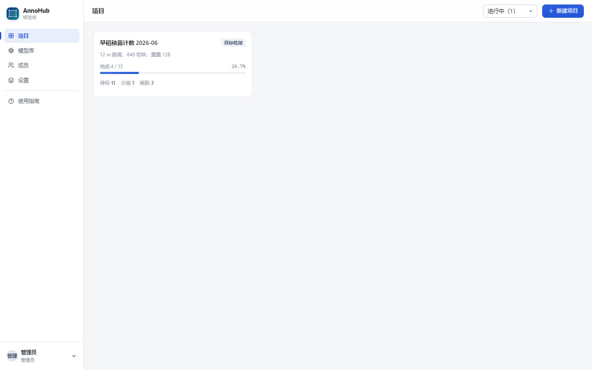
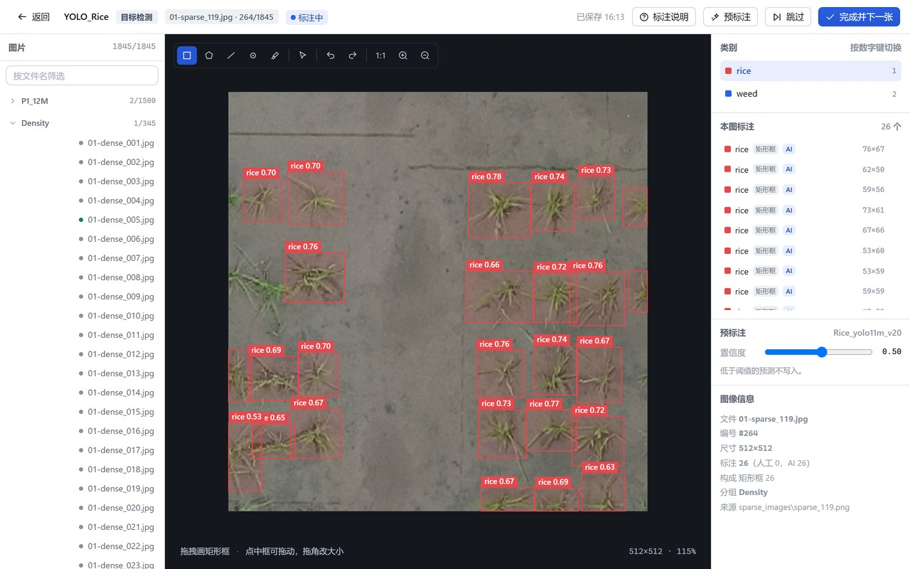
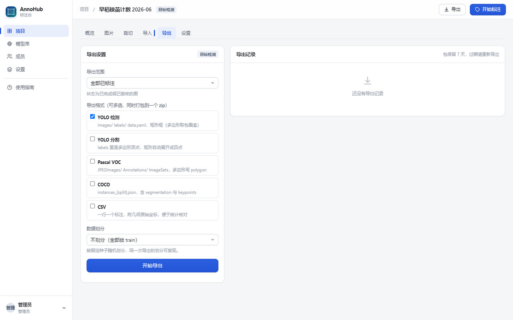

# AnnoHub

局域网多人协作图像标注平台。单文件部署在 Windows 主机上，成员用浏览器访问，客户端零安装。面向需要自建数据集的研究组与小团队，覆盖大图裁切、多人标注、模型预标注与多格式导出。

[](LICENSE)
[](https://github.com/Oryza-G/AnnoHub/releases/latest)




## 解决的问题

课题组要做目标检测，通常卡在同一处：几千张航拍大图要切成小图，切完要分给几个人标，标完要导成训练框架能读的格式。每一步都有现成工具，串起来却要人工搬数据、改路径、对类别名。

AnnoHub 把这四步放进同一个界面，数据始终留在本地，不依赖任何云服务。服务端与前端合并在一个可执行文件里，双击即用；成员在同一局域网用浏览器打开地址即可协作，不需要装 Python、不需要装客户端。

## 主要能力

| 环节 | 能力 |
|---|---|
| 图片准备 | 大图按指定窗口切块，支持重叠与贴边对齐；已裁好的图片整目录导入，哈希判重 |
| 标注形式 | 矩形框、多边形、折线、点、画笔、整图分类，同一张图内可混用 |
| 协作 | 图片级独占锁、心跳续期、任务分配、按成员与按分组统计进度 |
| 预标注 | 导入 ONNX 模型（检测、分割、分类），单张、勾选若干张、整批三种跑法 |
| 导出 | YOLO 检测、YOLO 分割、YOLO 分类、Pascal VOC、COCO、CSV，十种划分比例 |
| 数据交换 | 读入 YOLO txt、VOC xml、COCO json、LabelMe json、CSV 五种既有标注 |
| 账号 | 自助注册、注册审批、角色区分、命令行重置管理员密码 |
| 界面 | 明亮、深色、护眼三套主题，全站可切换并记忆 |



## 快速开始

### 方式一：直接用打包版

1. 从 [Releases](https://github.com/Oryza-G/AnnoHub/releases/latest) 下载 `AnnoHub.exe`（约 49 MB），放进一个空目录。
2. 双击运行。首次启动在同目录生成 `data` 文件夹。
3. 浏览器自动打开 `http://127.0.0.1:8765`，用 `admin / admin123` 登录。
4. 把启动窗口中打印的地址发给同事，他们用浏览器打开即可。

关闭控制台窗口即停止服务。

### 方式二：从源码运行

要求 Python 3.10 以上。

```bash
git clone https://github.com/Oryza-G/AnnoHub.git
cd AnnoHub
pip install -r requirements.txt
python run.py
```

数据目录默认在项目下的 `data`，可用环境变量 `ANNOTOHUB_DATA` 指向其他位置。

### 局域网访问

默认监听 `0.0.0.0:8765`。同事打不开页面，多数情况是防火墙未放行端口：

- 以管理员身份运行一次程序，启动时自动添加放行规则；
- 或在「设置 → 局域网访问」点「一键放行端口」，在系统弹窗中确认。

设置页同时提供计算机名与各网卡 IP 的复制框，以及一段可直接转发给成员的说明。

## 使用流程

新建项目 → 选项目类型与类别 → 裁切或导入图片 → 分配任务 → 标注（可先跑预标注）→ 导出训练集。

项目类型有四类：目标检测、实例分割、图像分类、其他。类型只描述主要产出什么，不限制标注工具，除图像分类外画布上的五种工具随时可切换。

完整操作说明见 [使用手册](docs/manual.md)。

## 导出的数据集结构

YOLO 检测：

```
images/train/  images/val/
labels/train/  labels/val/
data.yaml
manifest.csv
README.txt
```

同时勾选检测与分割时，标签分目录输出为 `labels/` 与 `labels_seg/`，避免互相覆盖；包内附 `README_yolo.txt` 说明对应关系。

分类任务导出为 ImageFolder 结构，可直接被 Ultralytics 或 `torchvision.datasets.ImageFolder` 读取。

| 格式 | 目录 |
|---|---|
| YOLO 检测 | `images/` `labels/` `data.yaml` |
| YOLO 分割 | `images/` `labels/`（多边形顶点） |
| YOLO 分类 | `images/{train,val}/{class}/` |
| Pascal VOC | `JPEGImages/` `Annotations/` `ImageSets/` |
| COCO | `instances_{split}.json` |
| CSV | 单表，保留几何原始坐标 |



## 技术构成

| 层 | 选型 |
|---|---|
| 服务端 | FastAPI + uvicorn，SQLite（WAL） |
| 前端 | 原生 JavaScript ES modules，零构建步骤 |
| 图像 | Pillow |
| 推理 | onnxruntime，CPU 即可运行，可换 GPU 版 |
| 打包 | PyInstaller 单文件 |

几何数据用 `geom_type` 加 `geom_json` 存储，矩形额外冗余 x1/y1/x2/y2 四列用于统计筛选。坐标为原图像素坐标，缩放只在渲染层发生，导出不做取整。

并发用图片级租约锁：客户端每 30 秒心跳，90 秒未续期自动释放；保存时校验版本号，冲突返回 409 而不是覆盖他人工作。

## 目录结构

```
annohub/
├─ annohub/            后端：路由、数据库、裁切、导入、导出、推理
├─ web/                前端：视图、样式、静态资源
├─ tools/              辅助脚本（ONNX 导出、冒烟测试、截图）
├─ docs/               使用手册与截图
├─ run.py              启动器
├─ build.spec          PyInstaller 打包配置
└─ requirements.txt
```

运行后生成的 `data` 目录包含数据库、图片、缩略图、导出包与模型库，已在 `.gitignore` 中排除。

## 命令行参数

| 参数 | 作用 |
|---|---|
| `--port N` | 指定端口，默认 8765 |
| `--host A` | 监听地址，默认 0.0.0.0 |
| `--no-browser` | 不自动打开浏览器 |
| `--reset-admin [密码]` | 重置管理员密码后退出 |
| `--promote 用户名` | 提升指定账号为管理员后退出 |
| `--list-users` | 列出全部账号后退出 |

忘记管理员密码时，在程序目录执行 `AnnoHub.exe --reset-admin`，密码恢复为 `admin123`。

## 已知限制

- 只接受 ONNX 模型，`.pt` 需先用 `tools/export_onnx.py` 转换。
- 以静态图片为单位，不支持视频逐帧标注与 DICOM 序列。
- 按局域网设计，未做 TLS 与公网加固，不建议直接暴露到公网。
- 单项目建议不超过 2 万张图片，并发标注建议不超过 8 人。
- 导出划分以图片为单位，不是分层抽样，类别极不均衡时需人工调整。

## 许可证

[MIT](LICENSE)
