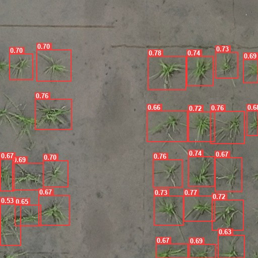
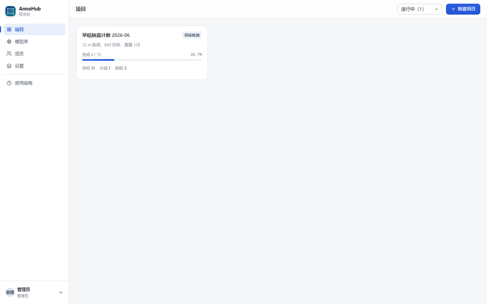
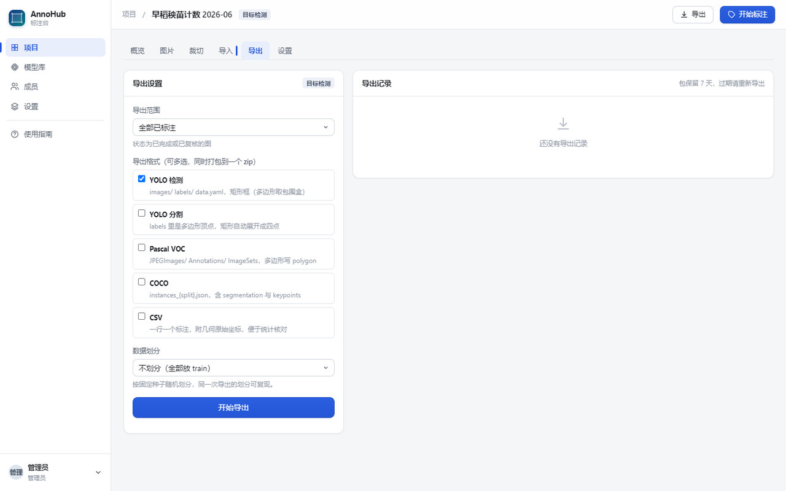

# AnnoHub

[English](README.md) | **简体中文**

面向局域网的图像标注服务端。一个 exe，一个局域网地址，不需要 Docker，不依赖任何云服务。

[](LICENSE)
[](https://github.com/Oryza-G/AnnoHub/releases/latest)




*水稻秧苗模型在 512×512 小块上的预标注结果。红框是模型预测，框上的数字为置信度。*

## 为什么做这个

遥感、植保、育种方向的研究组常见这样一种处境：手上有几千张无人机原图，交付日期是确定的。接下来要做四件事，把大图切成小图，把图分给几个人，避免两个人标同一张，最后导出成训练框架能直接读的格式。

每一步单独看都有成熟工具。串起来就要手工搬目录、对齐类别名、统一三种标签格式，训练前先耗掉几天。能一次覆盖四步的 CVAT 与 Label Studio 需要 Docker，需要有人维护，通常还要一台带显卡的机器。

AnnoHub 面向中间那种情况：一台 Windows 工作站，一个共享盘，没有运维预算。服务端与网页界面打包在同一个 49 MB 的可执行文件里。双击运行，把窗口打印的地址发给同组的人，他们用浏览器就能标注，不装客户端，也不注册任何第三方账号。

数据始终留在运行 exe 的那台机器上。

## 能做什么

**准备图片。** 把 12000×9000 的拼接图切成 640×640 的小块，重叠宽度与贴边对齐可调，输出 JPG 或 PNG。也可以直接导入已经切好的目录，按内容哈希去重。

**标注。** 矩形、多边形、折线、点，以及拖动后自动闭合成多边形的画笔，另加整图分类。除图像分类外的项目类型里六种工具随时可切换，项目类型只决定默认选中哪个工具、默认导出哪种格式。

**分配。** 自助注册加管理员审批，角色区分，任务可按成员分配，也可按来源分组批量派发。进度按成员、按分组、按项目三个口径统计。

**大批量图片列表。** 标注页左侧的图片列表一次取全项目元数据，只渲染展开的分组。1845 张图打开就是 1845/1845，不需要连点十几次“加载更多”；折叠分组只切显示状态，不重建列表。

**预标注。** 导入 ONNX 模型，检测、实例分割、分类三类都能跑，可作用于单张、勾选若干张或整批。人的工作从画框变成改框。不需要装 PyTorch 和 CUDA，CPU 上的 onnxruntime 处理小块图足够。

**导出。** 6 种格式 × 10 种划分比例 × 6 种导出范围，打成 zip，内含清单与格式说明。检测与分割同时导出时分目录存放，不会互相覆盖。

## 快速开始

**用打包版。** 从 [Releases](https://github.com/Oryza-G/AnnoHub/releases/latest) 下载 `AnnoHub.exe`，放进一个空目录，双击运行。首次启动在 exe 同级生成 `data` 文件夹。浏览器自动打开 `http://127.0.0.1:8765`，用 `admin / admin123` 登录并立即改密码。Windows 会提示未知发布者，这是没有代码签名证书的正常现象。

**从源码运行。** 需要 Python 3.10 以上。

```bash
git clone https://github.com/Oryza-G/AnnoHub.git
cd AnnoHub
pip install -r requirements.txt
python run.py
```

数据目录默认是项目下的 `data`，可用环境变量 `ANNOTOHUB_DATA` 改到别处。

**让别人访问。** 服务默认监听 `0.0.0.0:8765`。同事打不开页面，绝大多数情况是 Windows 防火墙没有放行端口。以管理员身份运行一次程序，或在「设置 → 局域网访问」点「放行端口」并在系统弹窗中确认。同一页会列出各网卡的地址与复制按钮，以及一段可以直接转发到群里的说明。

## 使用流程

新建项目 → 选类型与类别 → 裁切或导入图片 → 分配任务 → 标注（可先跑预标注）→ 导出。

项目类型分四类：目标检测、实例分割、图像分类、其他。类型描述主要产出什么，不限制可用工具。关键点、折线、旋转框这类需求选「其他」，工具全开。



完整操作说明见 [使用手册](docs/manual.md)。

## 并发写入怎么处理

两个人打开同一张图，是共享目录式标注最容易出事的地方，而且往往事后才发现。AnnoHub 把冲突控制放在图片这一级，而不是项目这一级。

打开图片即取得租约，客户端每 30 秒续期，超过 90 秒未续期自动释放，浏览器崩溃不会让一张图永久锁死。保存时带上进入编辑时的版本号，若期间有人先保存过，本次写入返回 `409` 并要求重新载入，而不是覆盖对方的工作。

几何数据以 `geom_type` 加 `geom_json` 存储，矩形另外冗余 `x1/y1/x2/y2` 四列用于筛选与统计。坐标一律是原图像素，缩放只发生在渲染层，导出不做取整。

## 导出格式

| 格式 | 结构 |
|---|---|
| YOLO 检测 | `images/` `labels/` `data.yaml` |
| YOLO 分割 | `images/` `labels/`，多边形顶点 |
| YOLO 分类 | `images/{train,val}/{class}/` |
| Pascal VOC | `JPEGImages/` `Annotations/` `ImageSets/` |
| COCO | `instances_{split}.json`，含 `segmentation` 与 `keypoints` |
| CSV | 一行一个标注，原始坐标 |

YOLO 检测包的结构：

```
images/train/  images/val/  images/test/
labels/train/  labels/val/  labels/test/
data.yaml
manifest.csv
README_yolo.txt
```

划分比例有 `none`、`9:1`、`8:2`、`7:3`、`3:1`、`1:1`、`8:1:1`、`7:2:1`、`6:2:2`、`7:1.5:1.5` 十种。导出范围可限定为复核通过的图、我自己标的图、某个来源分组，也可以放宽到包含未标注的图，用于先看数据分布。

已有标注可以读回来：YOLO txt、Pascal VOC xml、COCO json、LabelMe json、CSV 五种。接手别人做了一半的数据集时不必重标。



## 命令行

| 参数 | 作用 |
|---|---|
| `--port N` | 指定端口，默认 8765 |
| `--host A` | 监听地址，默认 0.0.0.0 |
| `--no-browser` | 启动时不打开浏览器 |
| `--reset-admin [密码]` | 重置管理员密码后退出 |
| `--promote 用户名` | 把已有账号提升为管理员后退出 |
| `--list-users` | 列出全部账号后退出 |

唯一的密码丢了，在程序目录执行 `AnnoHub.exe --reset-admin`，密码恢复为 `admin123`。

## 技术构成

| 层 | 选型 |
|---|---|
| 服务端 | FastAPI + uvicorn，SQLite 开启 WAL |
| 前端 | 原生 JavaScript ES modules，无构建步骤 |
| 图像 | Pillow |
| 推理 | onnxruntime，默认 CPU，可换 GPU 版 |
| 打包 | PyInstaller 单文件 |

```
annohub/
├─ annohub/          后端：路由、数据库、裁切、导入、导出、推理
├─ web/              前端：视图、样式、静态资源
├─ tools/            辅助脚本（ONNX 导出、冒烟测试、截图）
├─ docs/             使用手册与截图
├─ run.py            启动器
├─ build.spec        PyInstaller 打包配置
└─ requirements.txt
```

## 明确的限制

以下都是确实存在的问题，把数据集交给它之前值得先读一遍。

- 只接受 ONNX。`.pt` 要先用 `tools/export_onnx.py` 转换。
- 处理静态图片，不处理视频。没有抽帧，也没有 DICOM 序列。
- 按局域网设计。没有 TLS，没有做公网加固，不要做端口映射暴露出去。
- 单项目两万张图、八个人同时标注是舒适区。再往上，SQLite 与单进程 uvicorn 会成为瓶颈。
- 划分是图级随机，不是分层抽样。类别严重失衡时需要事后调整。
- 打包版仅 Windows。源码在 Linux 与 macOS 上可运行，但未做测试。

## 参与改进

AnnoHub 最初只为解决一个课题组的问题，之所以公开，是因为这个问题相当普遍。它是一个能用的工具，不是完成品。最需要外部帮助的地方，恰恰是一个人测不出来的部分：别人的显卡、别人的标签习惯、别人团队的工作方式。

提问题与写代码同样有价值。遇到故障，请附上启动横幅里的版本号、Windows 版本和触发步骤；一张控制台截图比一段描述有用得多。缺某种格式支持，开 issue 时带一个小样本文件和期望的目录结构，这类改动通常范围可控。

翻译、手册纠错、你们组实际怎么用它，都欢迎写进来。改动较大时，比如换存储后端、改锁模型、重写前端，请先开 issue 把方案说清楚，再花一个周末去实现。

没有贡献者协议，也没有固定路线图。Pull request 提到 `main`，改动集中一些，并说明你测过什么。

## 许可证

[MIT](LICENSE)。允许商用、修改与再分发。
